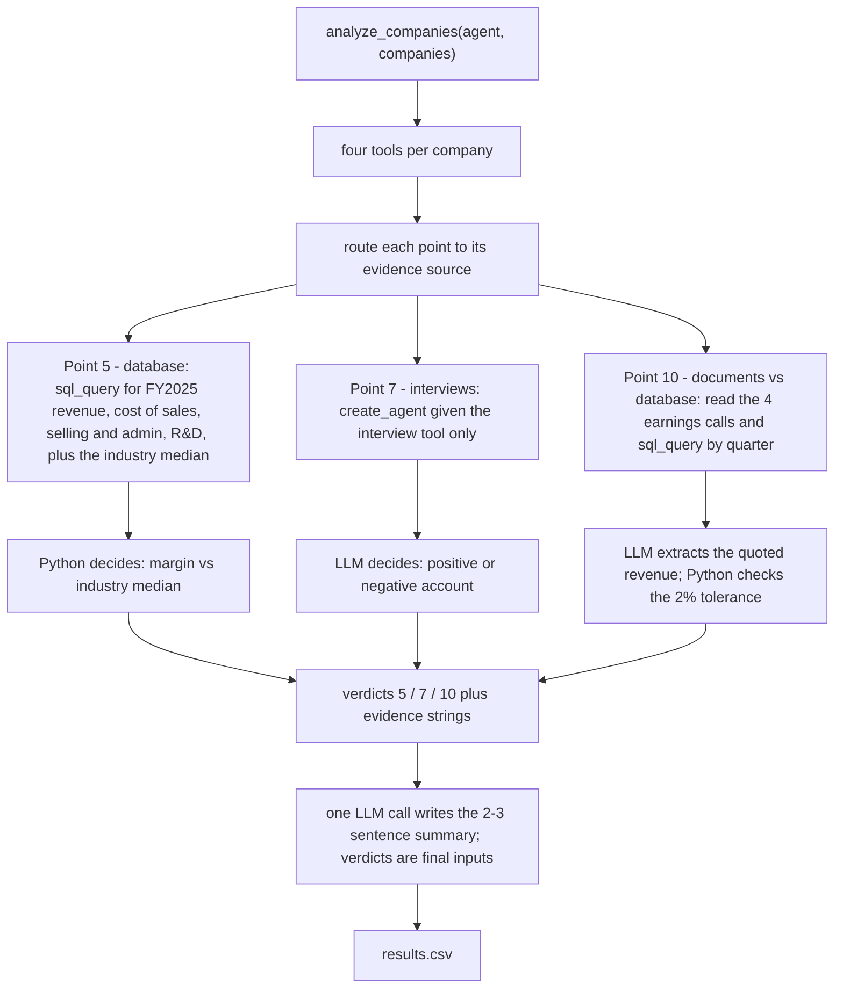

# FTEC5660 Homework 3: Fisher's 15-Point Investment Agent

Build a LangChain agent that researches a company with tools and applies the
framework from Philip Fisher's *Common Stocks and Uncommon Profits* (Part One,
Chapter 3 "What to buy: the fifteen points to look for in a common stock", and
Chapter 4 "What to buy: applying this to your own needs"). You choose 3 of
Fisher's 15 points and decide yourself what PASS means for each. For every
company your agent gives a PASS/FAIL verdict on your 3 points and a short
summary.

The companies are fictional, so the model cannot answer from memory. Unlike a
pile of reports, the evidence is spread over three sources, and your agent has
to go and get it with tools, the way Fisher's "scuttlebutt" method sends an
investor to talk to customers, competitors, suppliers and staff.

## Data and tools

`public_test/` has one folder per company. Your code receives four tools per
company (built by the provided code in `hw3.py`):

| Tool | What it gives you |
| --- | --- |
| `list_documents()` | the company's six documents and their dates |
| `read_document(name)` | one document: the 2025 letter to shareholders, four earnings calls (Q3 2025 to Q2 2026) and a news file (July 2025 to July 2026) |
| `sql_query(query)` | one read-only SQLite query on the company's database; at most 50 rows come back, so use `SUM`, `GROUP BY` and `WHERE` |
| `interview(role, topic)` | what one person says about the company; at most **10 interviews per company** |

The documents are what management says. Management's own claims (such as "we
have never cut research" or "our people are our greatest strength") are not
evidence on their own: check them against the database and the interviews.

**Database tables** (amounts in USD thousands; dates `YYYY-MM-DD`, months
`YYYY-MM`, quarters like `2025Q3`; the fiscal year is the calendar year):

| Table | Columns |
| --- | --- |
| `company` | name, industry |
| `industry_medians` | industry, revenue_growth_2y_pct, new_product_share_pct, new_product_sales_per_rd, operating_margin_pct (one row per industry; use the row for the company's own industry) |
| `orders` | order_id, order_date, product, customer, amount, note (about 3,000 to 4,000 orders from January 2023 to June 2026; revenue is the sum of order amounts) |
| `products` | product, launch_date |
| `monthly_costs` | month, cost_of_sales, selling_admin, research_development |
| `quarterly_cash` | quarter, operating_cash_flow, capex, cash_end |
| `capex_plan` | year, planned_capex (2026 to 2028) |
| `returns` | month, units_shipped, units_returned |
| `insider_trades` | trade_date, person, title, side (`buy` or `sell`), shares, price |

**Terms used in the data.**

| Term | Meaning |
| --- | --- |
| FY2025 | Fiscal year 2025. Here the fiscal year is the calendar year, so FY2025 is January to December 2025. |
| Quarter | Three months of the year: Q1 is January to March, Q2 April to June, Q3 July to September and Q4 October to December. The database writes `2025Q3`; the documents write "third quarter 2025". |
| Amounts | The database is in **USD thousands** (676,100 means US$676.1 million). The documents use USD millions. |
| Revenue | Money from sales: the sum of `amount` in `orders`. |
| Cost of sales | The cost of making the products that were sold. |
| Selling and admin | The cost of selling and of running the company (sales staff, offices, management). |
| R&D | Research and development spending, mainly on new products. |
| Operating margin | Operating profit as a share of revenue: (revenue − cost of sales − selling and admin − R&D) ÷ revenue. |
| Operating cash flow | Cash that the day-to-day business brings in during a quarter. |
| Cash at the end of a quarter | The cash the company holds on the last day of that quarter (`cash_end`). |
| Capex | Capital expenditure: spending on factories, machines and other long-term assets. `capex_plan` holds the planned capex for 2026 to 2028. |
| Return rate | Units returned ÷ units shipped, from the `returns` table. |
| Industry median | The middle value for companies in the same industry, from `industry_medians`. |
| Insider | A director or senior manager of the company. `insider_trades` lists the shares they bought (`buy`) or sold (`sell`). |
| Earnings call | A meeting each quarter where management presents the quarter's results to investors. Each call quotes that quarter's revenue. |

**Interviews.** Roles: `customer`, `current_employee`, `former_employee`,
`competitor`, `supplier`. Topics: `sales_team`, `working_conditions`,
`top_management`, `decision_making`, `competitive_edge`. Only some people know
about each topic; the others say they can't comment, and that answer still
uses up one interview.

| Topic | Who knows about it |
| --- | --- |
| `sales_team` | customer, competitor |
| `working_conditions` | current_employee, former_employee |
| `top_management` | former_employee, supplier |
| `decision_making` | supplier, customer |
| `competitive_edge` | competitor, customer |

People who know about a topic always agree with each other, so one good answer
is enough.

## Choose your 3 points and your rules

Pick any 3 of Fisher's 15 points and write them in `CHOSEN_POINTS` near the
top of `hw3.py`, e.g. `CHOSEN_POINTS = [1, 7, 15]`. The full questions are in
`FISHER_POINTS` in `hw3.py` and in the book.

| # | Fisher's point | Where the evidence is |
| --- | --- | --- |
| 1 | Market potential for sales growth | database |
| 2 | New products as current lines mature | database |
| 3 | Effective research and development | database |
| 4 | Above-average sales organization | interviews (`sales_team`) |
| 5 | Worthwhile profit margin | database |
| 6 | Maintaining or improving margins | database |
| 7 | Labour and personnel relations | interviews (`working_conditions`) |
| 8 | Executive relations | interviews (`top_management`) |
| 9 | Depth of management | interviews (`decision_making`) |
| 10 | Cost analysis and accounting controls | earnings calls, checked against the database |
| 11 | Advantage over competitors | interviews (`competitive_edge`) |
| 12 | Long-range outlook on profits | database |
| 13 | Growth without dilutive equity financing | database |
| 14 | Management talks freely about troubles | earnings calls, checked against the database |
| 15 | Management of unquestionable integrity | news file, checked against the database |

For each of your points, **you design the rule**: which evidence to use, what
to compute or whom to ask, and where the line between PASS and FAIL lies. PASS
means the company looks favourable on that point, as Fisher would see it.

We grade your verdicts against our own answer key. It uses one fixed rule per
point, which we do not publish, and the data never puts a company close to
the line of that rule, so a sensible reading of Fisher usually gives the same
answer. **Test your rules on the public answers**:
`public_test/ground_truth.json` gives the expected verdict on all 15 points
for each of the 20 public companies, and every point fails in 6 of them. If
your rule disagrees with the public answers, rethink it.

**Tip: calculate with tools, not in your head.** Do every sum, ratio and
comparison in SQL or Python, including the number of days between two dates
(SQLite's `julianday()` gives a date as a number of days).

## Student task

Fill in the three places in `hw3.py` marked `### YOUR CODE HERE`. You may add
imports, constants and helper functions above them, but do not change the
provided code below them:

- `CHOSEN_POINTS` lists your 3 points.
- `build_agent()` creates your model and anything else you need once.
- `analyze_companies(agent, companies)` receives
  `{company_folder: [list_documents, read_document, sql_query, interview]}`
  and returns, for every company,
  `{"points": {1: "PASS", 7: "FAIL", 15: "PASS"}, "summary": "..."}` (here with
  `CHOSEN_POINTS = [1, 7, 15]`).

Use the course techniques that fit your points: tool use for the database and
the interviews, planning which interviews to spend, routing each point to the
right source, prompt chaining, parallel calls, reflection to check your
answers, or a combination. Your code must read company data **only through
the four tools**; do not open `company.db` or `interviews.dat` yourself. Do
not hard-code folder names, company names or the public answers.

## Setup and public test

```bash
python3 -m venv .venv
source .venv/bin/activate
pip install -r requirements.txt
echo "DEEPSEEK_API_KEY=your_key_here" > .env
python3 hw3.py --data-folder public_test
```

Use your own DeepSeek API key (from https://platform.deepseek.com). The
required model is `deepseek-v4-flash`. We grade with our own key, so never put
a key in your code; `.env` must stay out of git.

The program creates `results.csv` with the columns `company`, `points`,
`points_correct`, `point_errors`, `interviews_used` and `summary`, and prints
the point score on your 3 points (the percentage after "balanced"). The point
score is the average of two shares: the share of truly passing verdicts that
you marked PASS and the share of truly failing verdicts that you marked FAIL.
For example, 90% and 60% give (90% + 60%) / 2 = 75%, and marking every point
PASS gives (100% + 0%) / 2 = 50%. Once `CHOSEN_POINTS` is set, the starter
runs before you add any API code (it returns no verdicts, so it scores 0%).

`public_test/ground_truth.json` gives the expected verdicts on all 15 points
for each public company. Grading uses a private set of about 20 unseen
companies with the same tools and the same answer key rules, but different
names and wording, and scores your 3 points only.

## Homework 3 solution

### My 3 points and rules

**Point 5 — "Does the company have a worthwhile profit margin?"**

*Why this point.* It is the cheapest honest test of whether the business is worth owning, and it is the one point where the company's own filings are least able to hide anything: revenue and the three cost lines have to add up. Fisher is careful to separate profit margin from profit volume, so the number has to be read against the economics of the company's own industry rather than against a single magic percentage.

*PASS rule.* Compute the FY2025 operating margin from the database,
`(revenue − cost of sales − selling & admin − R&D) / revenue`, with revenue the sum of `orders.amount` for 2025 and the three cost lines summed from `monthly_costs` for the same twelve months. Compare it with `industry_medians.operating_margin_pct` for the company's own industry. **PASS if margin ≥ the industry median, FAIL otherwise.** The arithmetic is done in SQL and Python, never in the model's head.

*Evidence.* One SQL query over `orders`, `monthly_costs` and `industry_medians`, plus a check that twelve months of cost data exist. Management's claims are deliberately not used: the annual letter says things like "our gross margin was among the best in our industry", which is exactly the kind of sentence that is not evidence.

**Point 7 — "Does the company have outstanding labor and personnel relations?"**

*Why this point.* It is the purest application of Fisher's scuttlebutt: the only way to know how a company treats its people is to ask them. No database column records morale, so this point forces the agent to spend interviews rather than read tables.

*PASS rule.* Ask a `current_employee` about `working_conditions` (falling back to `former_employee` only if the first cannot comment). **PASS if the account is clearly positive** — fair pay, people staying for years, problems fixed when raised, low turnover. **FAIL if it reports chronic overtime, monthly attrition, strike threats or pay complaints.** At most 2 of the company's 10 interviews are spent, and the interview limit is never approached.

*Evidence.* Interviews only. The letter's "our people are our greatest strength" is management talking about itself; per the brief, that is not evidence of labour relations.

**Point 10 — "How good are the company's cost analysis and accounting controls?"**

*Why this point.* It is the only point that tests whether management's own numbers survive contact with the accounting records — the internal-consistency check an investor would actually run.

*PASS rule.* Read all four earnings calls, extract the revenue figure management quotes for each quarter, and compare it with the database's quarterly sum of `orders` (converted from USD thousands to millions). **PASS if every quarter agrees within 2%; FAIL if any quarter is overstated or understated by more than that.**

*Evidence.* The earnings calls, cross-checked against the database, as the assignment's evidence table requires.

*One lesson worth recording.* My first version of point 10 added a second, softer criterion: PASS only if management also discusses cost controls "specifically and substantively". It scored 83.3% — it failed 14 of the 20 public companies. The reason is that the CFO's line ("We kept a close eye on costs across our plants. Returns stayed low and product quality was steady.") is boilerplate that appears word for word in good and bad companies alike, so the criterion collapsed every company to FAIL. That is the README's warning made concrete: management's own claims are not evidence on their own. Only the reconciliation against the database separates the six genuinely weak companies — each of them overstates exactly one quarter's revenue by 7–9%, while the others match to within 0.1%. Removing the subjective criterion took the point from 6/20 to 20/20.

### Design



The agent is a router rather than a single general-purpose tool-calling loop. Each of the three points is sent to the source the assignment designates for it, and the tool that point needs is the only one it is given: point 7's sub-agent sees just the `interview` tool, so it cannot wander into the database. Every number is computed in SQL and Python and handed to the model as a settled fact; the model is used for exactly two jobs, reading prose (what revenue did management quote, is this employee account positive or negative) and writing the final summary. That split is what makes the run deterministic enough to score the same on repeated runs, and fast: 20 companies finish in about 26 seconds against a 30-minute budget, spending one or two interviews per company. Verdicts are assembled before the summary is written and are passed in as finals, so the summary cannot talk the agent out of a verdict its own arithmetic produced; per-company exceptions are caught and still produce an entry, so one bad API call cannot cost the whole `results.csv`.

### Results

On `public_test` (20 companies × 3 points = 60 verdicts) the agent scores **60/60 point verdicts, balanced 100.0%**, in 26 seconds, spending one interview per company except one, where the first answer could not be judged and a second was used.

There is therefore no company where the submitted verdicts disagree with the public answers. The disagreements that existed during development were all point 10, and they were systematic rather than random: a first version that required management to discuss cost controls "substantively" marked 14 truly-passing companies FAIL (83.3% balanced). The fix was to drop that subjective criterion and decide point 10 purely by reconciling the quoted quarterly revenue against the database. Two other robustness changes came out of the same review: earnings-call documents are now discovered through `list_documents()` instead of hard-coded filenames, and an interview that cannot be judged falls back to one more interview plus a second judgement rather than silently defaulting.

The remaining risk is honest to state: the private set uses the same answer key but different wording, so the rule that could move is point 5. The weakest passing company in the public set sits 1.7 percentage points above its industry median and the worst failing company 1.9 points below, so a company whose margin lands almost exactly on its industry median would be a coin flip, and the wording of the earnings calls is now the only thing standing between the extractor and the point-10 verdict.

## Task 2: Reflection on AI-sycophancy and AI-psychosis

**Sycophancy.** What this homework actually punished was not a model that lies, but a model that agrees. My first point-10 rule asked the model whether management discussed cost controls "specifically and substantively", and the model answered the way the question was framed: it found a reason to call the boilerplate inadequate, uniformly, for all twenty companies. That is sycophancy in its most useful disguise — not flattery of the user, but deference to the shape of the prompt. The rule felt analytical and produced a confident 83.3%, and nothing in the output said "this criterion does not discriminate". The score did.

The same pull appears in the metric itself. Because most true verdicts are PASS, an agent that answers PASS everywhere is right 70% of the time and sounds calibrated; the balanced score exists precisely to take that comfort away, and it drops the lazy agent to 50%. I ended up treating the balanced score as the only honest feedback signal, and treating every extra criterion I added as something that had to earn its place against it. The general lesson is that a model will happily produce a justification for whichever rule I hand it, so the rule has to be defensible before the model sees it — in this case, a number that can be recomputed from the database, not a judgement about the quality of a sentence.

**AI-psychosis.** The milder version of this is not delusion but fluency without referent, and I hit it directly. In an intermediate run the point-7 verdict was never passed into the summary prompt, and the model wrote, in perfectly composed prose, "Point 7 was not assessed here because no Point 7 data or rule was supplied" — for every company, in a report that was supposed to explain all three verdicts. Nothing crashed. The CSV was well-formed. A reader skimming the summaries would have seen an analyst's voice describing an analysis that had not happened. When a system always produces a plausible sentence, the absence of evidence stops looking like an absence: it looks like a judgement call.

That is the failure mode I would worry about at scale. A person working with a fluent agent gradually loses the ability to tell "the agent checked and found this" from "the agent wrote something that fits". The defence that worked here was structural rather than rhetorical: the arithmetic lives in SQL and Python, the model only reads and writes prose, the verdicts are fixed before the summary is written, and a missing piece of evidence is a loud empty string in the evidence log rather than a graceful sentence. Keeping the model away from the numbers was not a limitation of the design; it was the design.

There is a second, quieter risk on the human side. A 100% score on twenty companies feels like validation, and it is not: it is twenty examples drawn from one fixed answer key, on a task whose evidence was deliberately designed to be findable. The model did not become trustworthy; the data became checkable. The useful habit is to keep asking which part of the result is actually verified, and to notice that the answer is usually narrower than the number suggests.
